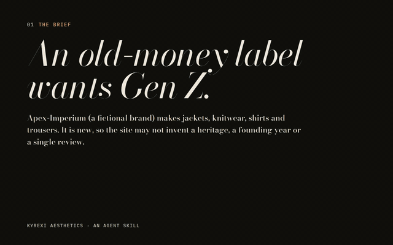

# Kyrexi Aesthetics

**Studio-level websites that tell the truth, built first for Indian brands.**

An Agent Skill that designs websites the way a studio does: it finds the feeling the page must create, shows you three directions, builds the one you choose with real craft and motion, and checks that the result is accessible, honest and free of dark patterns. It handles Hindi and other Devanagari scripts, Arabic right-to-left layouts, and the dark patterns named by India's Central Consumer Protection Authority, alongside EU, UK and US rules.

For landing pages, marketing sites and portfolios, in Claude Code or any agent that reads [Agent Skills](https://agentskills.io).

<p align="center"></p>
<p align="center"><sub>Brief → three directions → the chosen site. Demo brand Apex-Imperium is fictional; its photos and videos are AI-generated.</sub></p>

## What it does

- **Starts from the visitor, not a template.** An audience profile (age, language and script, device, context, accessibility needs) and a three-line *feeling brief*: what people come for, their moment, and what they must feel within three seconds.
- **Shows you three directions.** Three first-screen prototypes that differ in concept, interaction and visual language, each scored on Design, Usability, Creativity and Content. You choose; then it builds.
- **Art-directs the page.** Type with character, a palette taken from the subject, an asset cast (no repeated images), and a rule never to fake the focal object with clip-art drawings.
- **Moves with intent.** A signature motion plus a site-wide motion system (masked heading reveals, image reveals, pinned scroll scenes, magnetic buttons), from 16 technique recipes using GSAP, Lenis, CSS and an optional Three.js moment, with reduced-motion and no-JavaScript fallbacks.
- **Writes the photo and video brief.** When the page needs real photography, video or 3D, it writes a shot list your client can hand to a photographer: angle, lens, light, crop, phone settings and rights.
- **Checks its own work.** Screenshots at five widths, a motion film-strip and frame timing on a slowed CPU, WCAG 2.2 AA floors, page weight, AI-cliché ("slop") warnings, and a truth check that flags invented numbers, reviews and promises.
- **Refuses dark patterns.** No fake countdowns, pre-ticked boxes or shaming "no thanks" buttons, with notes on consumer rules in India, the EU, the UK and the US. Asked to sell harder, it uses the strongest honest persuasion instead.
- **Works beyond English.** Hindi and other Devanagari scripts, Arabic and other right-to-left layouts, and locale-aware defaults.

## Install

**Any agent, one command** (Claude Code, Codex, Cursor, Gemini CLI, GitHub Copilot and [many more](https://skills.sh)); needs Node.js:
```bash
npx skills add adi-mauryaji/Kyrexi-makes-it-aesthetics      # asks which agents; add -g to install for all your projects
```
**Claude Code (plugin):**
```
/plugin marketplace add adi-mauryaji/Kyrexi-makes-it-aesthetics
/plugin install kyrexi-aesthetics@kyrexi
```
**By hand:** copy `skill/kyrexi-aesthetics/` into your agent's skills folder.
```bash
git clone https://github.com/adi-mauryaji/Kyrexi-makes-it-aesthetics
cp -r Kyrexi-makes-it-aesthetics/skill/kyrexi-aesthetics ~/.claude/skills/
```

| Agent | All projects | One project |
|---|---|---|
| Claude Code | `~/.claude/skills/` | `.claude/skills/` |
| Codex | `~/.agents/skills/` | `.agents/skills/` |
| Cursor | `~/.cursor/skills/` | `.agents/skills/` |
| Gemini CLI | `~/.gemini/skills/` | `.agents/skills/` |

Any other agent: tell it to read `skill/kyrexi-aesthetics/SKILL.md` before designing.

**Optional tools for the checks:** Node.js 22 or newer with Chrome or Chromium (screenshots, motion, palette), and Python 3 (contrast, truth and memory scripts). Without them the skill follows manual checklists.

## Use

Ask in plain words; the skill starts when the request is about designing or building a site:

> Design a landing page for a small chai shop in Lajpat Nagar. Students and office workers, mostly on phones. Hindi and English. Make it stand out.

> Redesign my photography portfolio. I like these sites: … Keep it fast.

It will show you the audience profile and three directions before building, unless you ask it not to stop. You get the page plus `design/blueprint.md` (every decision with its reason), `design/asset-brief.md` (photos and video to commission), the list of facts it still needs from you, and the checks it ran.

## How it works

1. **Intake:** audience profile and the facts the page may use.
2. **Art direction:** taste memory, level (Clean or Studio), feeling brief, three directions, your choice, visual language.
3. **Asset brief** for the photos, video or 3D the page needs.
4. **Blueprint:** tokens, layout, motion, and a decision ledger tied to graded evidence.
5. **Build** at full craft, with finished-looking stand-ins until real assets arrive.
6. **Visual review:** award score, visual gate and motion gate, up to three rounds.
7. **Guards:** accessibility, performance, truth check and ethics guard, fixed without flattening the design.
8. **Handover:** the page, the documents, open questions, and what you kept or rejected for next time.

A lean panel of role cards (lead designer, devil's advocate, accessibility, ethics) reviews each step; a full eight-role panel runs on request. The 74 design rules carry evidence grades (A–D), so the skill says "research shows" only when strong research does.

## Repository

| Path | What |
|---|---|
| `skill/kyrexi-aesthetics/` | the skill: `SKILL.md`, `references/` (art direction, motion, recipes, evidence, panel cards, guards), `scripts/` (verify, motion, palette, contrast, claims, memory) |
| `skill/.claude-plugin/`, `.claude-plugin/` | Claude Code plugin and marketplace manifests |
| `skills.sh.json` | tells `npx skills` where the skill lives |
| `.github/demo.gif` | the demo above |

## Status

Version 0.2.0. The skill has been used on concept sites during development; feedback and issues are welcome, especially screenshots of what it made for you and what it got wrong.

## License

`SKILL.md` and scripts: Apache-2.0 (`LICENSE`). Reference content: CC BY 4.0 (`LICENSE-CONTENT`).
